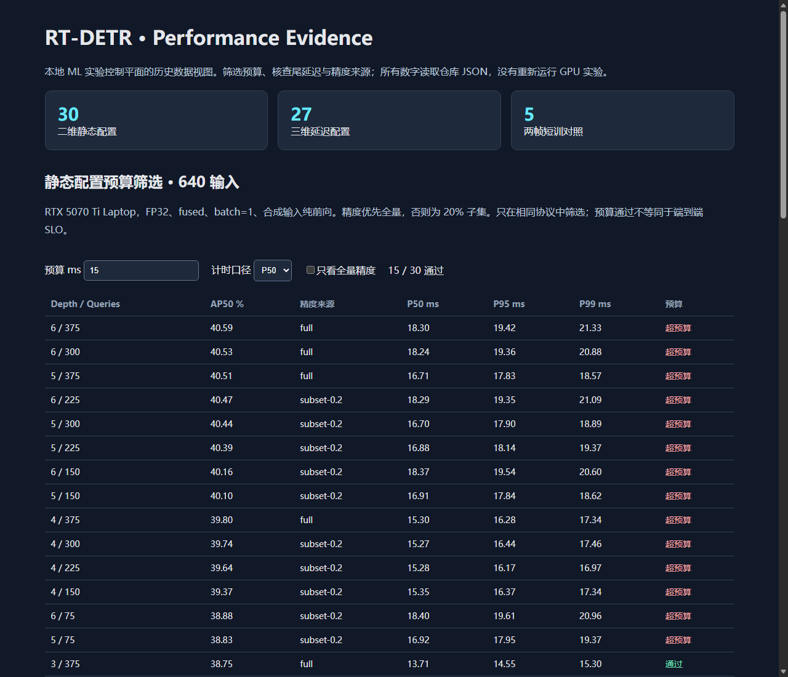
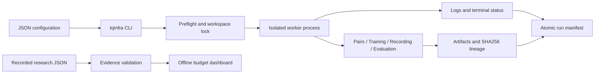

# RT-DETR Query Infra

**A local ML experiment control plane for stateful vision models.**

[](https://github.com/bmn2nppyn9-cmd/RT-DETR-Temporal-Query-Research/actions/workflows/ci.yml)


把一次性的 RT-DETR 研究脚本变成可配置、可追溯、可测试的本地 ML Infra：统一启动数据准备、训练、连续帧推理与评测 worker，记录运行配置、退出状态、代码/输入/产物哈希，并提供离线性能证据面板。

适合展示 **ML Systems / Inference Infra / Performance Engineering** 能力。边界是单机本地实验编排；当前实现不宣称分布式训练、在线高可用服务或生产集群调度。

## 5 分钟体验：不需要 GPU、权重或数据集

```bash
git clone https://github.com/bmn2nppyn9-cmd/RT-DETR-Temporal-Query-Research.git
cd RT-DETR-Temporal-Query-Research
python -m pip install -e .
python -m tqinfra demo --output artifacts/demo
```

打开 `artifacts/demo/report.html`：调整 P50/P95/P99 预算、筛选全量精度配置，并查看三维计时和两帧训练结果。

Demo 真实启动一个隔离子进程，生成日志、运行 manifest 和 SHA256 产物记录。该 worker 是确定性 CPU fixture，面板读取历史 GPU 测量；不将 fixture 耗时包装成模型性能。



## 工程能力

| 能力 | 实现 | 验证方式 |
|---|---|---|
| 配置与可移植性 | JSON 类型/字段验证，相对路径按配置文件解析，受管 worker 使用环境变量配置 | 路径含空格、非法配置测试 |
| 运行隔离 | 独立子进程、独占工作区文件锁，输出冲突预检查 | 跨进程互斥与失败测试 |
| 生命周期管理 | success / failure / timeout / cancellation，超时清理进程树 | 子进程树超时测试 |
| 实验追溯 | command、Git 状态、代码与输入 SHA256、产物哈希、原子 manifest 更新 | fixture 产物与日志校验 |
| 性能证据 | 30 点静态精度/延迟、27 点三维计时、5 组短训，明确协议和来源 | 指标范围、分位数顺序、损坏数据拒绝 |
| 有状态模型路径 | 前帧 query state、场景 reset、晚层注入、两帧训练、拆源评测 | 原模型 R1–R10 回归工具与受管任务入口 |
| 持续集成 | Windows/Linux、Python 3.10/3.13，lint、测试、demo 产物 | GitHub Actions |



## 运行真实模型

完整步骤见 [Quickstart](docs/quickstart.md)。已有数据和基线权重的用户可运行：

```bash
python scripts/setup_backend.py
python -m pip install -e vendor/ultralytics -c requirements-ml-constraints.txt
python -m pip install -e ".[evaluation]"
# 将 configs/local.example.json 复制为 configs/machine.local.json 并填写本机资产路径。
python -m tqinfra doctor --config configs/machine.local.json --probe
python -m tqinfra run prepare-pairs --config configs/machine.local.json
python -m tqinfra run regression --config configs/machine.local.json
python -m tqinfra run train --config configs/machine.local.json
python -m tqinfra run record --config configs/machine.local.json
python -m tqinfra run evaluate --config configs/machine.local.json
```

数据与模型是外部资产，仓库不隐式下载大型数据或启动训练。使用固定上游版本及研究补丁恢复模型依赖；普通 `pip install ultralytics` 没有时序训练 API。

## 现有研究证据

- 静态网格包含 **30 个深度 × query 配置**；只有 11 个配置有全量精度，其余标为 20% 子集。
- 三维网格包含 **27 个计时配置**，不推断尚不存在的分辨率精度结果。
- 同一历史评测协议下，三层训练基线 AP50 **38.77%**，S3→L3 两帧传播 **40.45%**，提高 **1.68pp**。这是历史 3 epoch 短训，不是最终标准 COCO/sAP 或生产 SLO 结论。
- query 动态退出探针当前没有真实加速；保留作为“计算量减少不必然降低延迟”的工程案例。

[性能测量协议与局限](docs/benchmarking.md) · [架构和故障语义](docs/architecture.md) · [求职项目讲解](docs/portfolio.md) · [验证记录](docs/validation.md)

## 开发

```bash
python -m pip install -e ".[dev,evaluation]"
ruff check tqinfra tests scripts
python -m pytest -q
python -m tqinfra validate-results
```

CPU control plane 仅使用标准库。源码树需要保留研究脚本、配置和结果 JSON，因此使用 **clone + editable install**；普通 wheel 不包含完整研究资产。

## 目录

```text
tqinfra/              # 配置、worker 生命周期、追溯、离线报告、CPU demo
tests/               # 控制层失败、锁、超时、数据一致性测试
configs/             # 可移植配置示例
scripts/             # 固定版本模型依赖安装
docs/                # 快速开始、架构、协议、项目讲解、验证记录
b1a_pair/            # 受管的两帧训练/录制/评测/回归 worker
patches/             # 固定 Ultralytics 基准与研究修改
upstream_snapshot/   # 修改后的四个源码文件，便于审阅
ablation_2d/          # 静态性能网格与结果
ablation_3d/          # 三维计时网格
query_depth_probe/   # 深度机制分析和评测依赖
query_prop_b0/       # 冻结传播失败诊断和评测依赖
```

根目录旧 profiling/绘图/探索脚本和 `query_*` 中未接入受管流程的脚本属于历史研究归档，可能仍含原机器路径。受支持的可移植入口是 `tqinfra` 五项受管任务，历史输出保留原协议和来源，不混充本次新测量。

欢迎fork！
