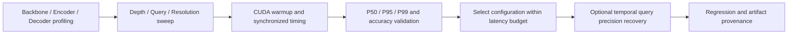

# RT-DETR Inference Optimization on NVIDIA GPUs

**NVIDIA GPU 上的 RT-DETR 推理性能优化与验证工具链。**

[](https://github.com/bmn2nppyn9-cmd/RT-DETR-Temporal-Query-Research/actions/workflows/ci.yml)


围绕一个具体工程问题：**在有限的单帧推理预算内，如何减少 RT-DETR 的执行耗时，并量化由此产生的精度损失？**

本项目以 PyTorch/CUDA 推理为基础，通过模块 profiling、解码器执行深度调整、query 数与分辨率扫描，找到可实际降低 NVIDIA GPU 前向延迟的配置；配套提供同步计时、尾延迟分析、精度回归、可追溯任务执行和离线性能面板。时序查询传播用于探索轻量配置的精度补偿。

## 核心结果：同权重三层推理降低约 24.9% 的前向耗时

测试设备为 **NVIDIA RTX 5070 Ti Laptop GPU**。下表来自同一份 RT-DETR-ResNet18 权重，FP32、fused、batch=1、640×640 合成输入。精度在 Argoverse-HD 全量验证集 15,062 帧上评测。

| 配置 | P50 前向延迟 | P95 | P99 | AP50 | AP50:95 |
|---|---:|---:|---:|---:|---:|
| 基线：6 层 / 300 queries | 18.24 ms | 19.36 ms | 20.88 ms | 40.53% | 23.93% |
| 轻量配置：3 层 / 300 queries | **13.70 ms** | **14.55 ms** | **15.15 ms** | 38.65% | 22.89% |

- P50 降低 **24.9%**，等价于约 **1.33×** 的纯网络前向加速；AP50 下降 **1.88 个百分点**。
- 优化通过 `decoder.eval_idx` 在第三层结束前向，实际跳过后续解码层，保持原权重，无需为这组静态结果重新训练。
- 在 **15 ms 的纯前向预算**下，三层配置的 P50/P95 达标，P99 仍略超预算。预算选择必须明确使用哪个分位数。

结果可直接核查：[原始 JSON](ablation_2d/out_grid_2d.json) 中的 `6_300` / `3_300`，以及 [CSV](ablation_2d/ablation_2d_results.csv)。前向计时不包含图像读取、预处理和后处理，不能直接解释为视频服务端到端延迟或吞吐。

## 优化与验证流程



| 工作 | 工程实现 | 已有证据 |
|---|---|---|
| 定位计算开销 | 分段测量 backbone、encoder、decoder，比较分辨率与精度模式 | `profile_rtdetr.py`、`bench_stages.py` |
| 减少解码计算 | 调整推理退出层，实测真实执行耗时与精度变化 | 6→3 层 P50 降低约 24.9% |
| 扫描配置空间 | 深度 × query 二维网格；增加分辨率形成三维计时网格 | 30 个二维配置、27 个三维计时配置 |
| 控制测量误差 | 预热、CUDA 同步、多轮交错测量，记录 P50/P95/P99 | 静态网格每配置 50 次预热、500 次计时 |
| 检查精度代价 | 子集筛选后对关键配置全量验证，检查类别匹配与 AP 聚合 | 二维网格 11 个全量精度配置；指标测试 |
| 补偿轻量模型精度 | 缓存前帧 query state、指定层注入、两帧训练与场景 reset | 五组短训结果与模型回归 |
| 支持可靠复现 | 配置校验、隔离 worker、独占工作区、超时进程树清理、日志与 SHA256 | `tqinfra`、故障测试、Windows/Linux CI |

query 数、理论计算量和延迟之间并非简单线性关系。动态 query 退出探针虽然减少了 query-layer 预算，但当前执行方式没有获得真实加速。这项结果也被保留，用于检验索引操作、小 kernel 和调度开销是否抵消理论收益。测量范围见 [Benchmarking](docs/benchmarking.md)。

## 快速查看性能结果

无需 GPU、模型权重或数据集即可查看已有测量和运行工程演示：

```bash
git clone https://github.com/bmn2nppyn9-cmd/RT-DETR-Temporal-Query-Research.git
cd RT-DETR-Temporal-Query-Research
python -m pip install -e .
python -m tqinfra demo --output artifacts/demo
```

打开 `artifacts/demo/report.html`，调整延迟预算与 P50/P95/P99 口径，查看满足预算的配置及精度来源。只比较全量验证结果时，勾选“只看全量精度”。


面板读取仓库已有 GPU 结果；demo 另行启动一个确定性 CPU fixture worker，演示日志、运行状态与产物追溯。它不执行 GPU benchmark。

## 运行与复现

### 1. 准备模型依赖

使用 NVIDIA GPU 时，先在独立 Python 环境安装适配本机驱动的 CUDA 版 PyTorch，再执行：

```bash
python scripts/setup_backend.py
python -m pip install -e vendor/ultralytics -c requirements-ml-constraints.txt
python -m pip install -e ".[evaluation]"
```

依赖恢复脚本检出固定 Ultralytics 提交并应用研究补丁。数据和权重是外部资产，具体布局与初始化条件见 [Quickstart](docs/quickstart.md)。

### 2. 重测解码深度延迟

在仓库根目录执行，传入实际基线权重路径：

```bash
python verify_depth_timing.py --model /path/to/baseline.pt --depths 3 6 --imgsz 640 --out artifacts/depth-timing.json
```

该脚本提供预热、多轮交错与 CUDA 同步计时。其测试协议与二维 fused 网格存在差异，重测结果应保留独立文件及测量说明，不能混用两套数字。

完整配置扫描入口为 `ablation_2d/eval_grid_2d.py` 和 `ablation_3d/eval_grid_3d.py`。它们保留原研究流程，运行前需配置脚本中的模型路径和 `cfg/argoverse-hd-local.yaml`，并将输出指向独立实验目录；原网格支持读取已有结果续跑，直接复用目录可能跳过已有配置。三维随仓库提供的结果仅包含计时。

### 3. 运行时序精度补偿流程

将 `configs/local.example.json` 复制为 `configs/machine.local.json`，填写数据、初始权重、patched backend、工作区路径；GPU 运行设置 `device: "0"`。

```bash
python -m tqinfra doctor --config configs/machine.local.json --probe
python -m tqinfra run prepare-pairs --config configs/machine.local.json
python -m tqinfra run regression --config configs/machine.local.json
python -m tqinfra run train --config configs/machine.local.json
python -m tqinfra run record --config configs/machine.local.json
python -m tqinfra run evaluate --config configs/machine.local.json
```

受管任务为每次运行保存配置、命令、代码与输入哈希、worker 日志、退出状态和产物哈希。输出冲突在启动前检查，训练失败返回非零状态，超时清理进程树。参见 [Architecture](docs/architecture.md)。

## 扩展：轻量配置的精度补偿

项目同时实现了前帧 query state 缓存、晚层注入与两帧训练，用于探索三层配置的精度补偿。传播训练与同权重静态计时是不同实验；目前不将两者组合成无损加速结论。具体指标、历史对照审核和测量范围见 [Benchmarking](docs/benchmarking.md)。

## 工程验证

- **12 项自动测试通过**：跨进程互斥、失败状态、超时子进程清理、日志/产物追溯、损坏证据拒绝、类别匹配与空预测。
- **11 项真实模型回归通过**：三层结构一致性、传播关闭退化、梯度流、晚注入层宽、状态提取、checkpoint 往返等。
- **最小训练→推理→评测闭环通过**：基线与传播各 1 epoch；两个场景各三帧验证场景状态重置。
- **Windows/Linux、Python 3.10/3.13 CI 通过**，执行控制层与指标测试、lint 和 CPU demo。

本次工程验证在 CPU 环境完成；首页加速数字来自已有 RTX 5070 Ti Laptop CUDA 测量。GPU 性能与设备、dtype、batch、融合和输入尺寸相关，不能泛化成所有 NVIDIA 显卡的相同加速比例。[验证记录](docs/validation.md)

```bash
python -m pip install -e ".[dev,evaluation]"
ruff check tqinfra tests scripts
python -m pytest -q
python -m tqinfra validate-results
```

## 代码导航

| 目录 / 文件 | 内容 |
|---|---|
| `profile_rtdetr.py`、`bench_stages.py` | 模块性能分析 |
| `verify_depth_timing.py`、`verify_query_timing.py` | CUDA 延迟复核 |
| `ablation_2d/`、`ablation_3d/` | 配置扫描、精度/延迟结果与绘图 |
| `tqinfra/`、`configs/` | 受管任务、配置、运行追溯与性能面板 |
| `b1a_pair/` | 时序精度补偿的训练、录制、评测与回归 |
| `patches/`、`upstream_snapshot/` | 核心模型修改与固定上游版本 |
| `query_depth_probe/`、`query_prop_b0/` | 深度/传播诊断及公共评测依赖 |
| `tests/`、`.github/workflows/` | 自动测试与 CI |
| `docs/` | 运行、性能协议、架构与验证记录 |

当前公开实现覆盖 PyTorch/CUDA 模型执行路径与性能验证工具链。TensorRT、定制 CUDA kernel、量化部署和多流在线服务不属于已有成果。历史探索脚本可能仍含本机路径；可移植受管入口和研究 benchmark 的准备方式已分别说明。

## License

AGPL-3.0，见 [LICENSE](LICENSE)。模型实现基于 Ultralytics RT-DETR，保留其 [原始许可证](THIRD_PARTY/ULTRALYTICS_LICENSE.txt)；固定基准与补丁来源见 `patches/upstream.json`。`SOURCE_MANIFEST.json` 是首次整理时的来源快照。

欢迎 fork、复测不同 NVIDIA GPU 上的延迟与精度权衡。
